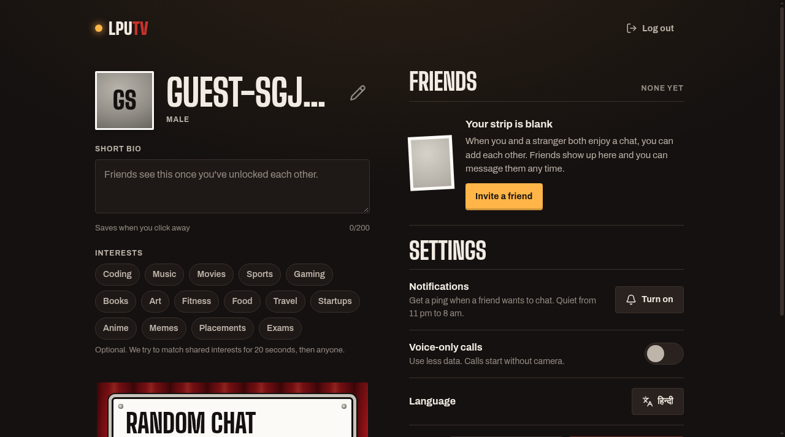
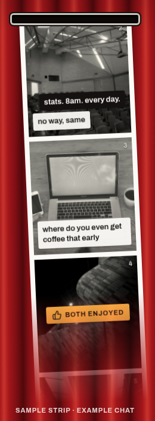
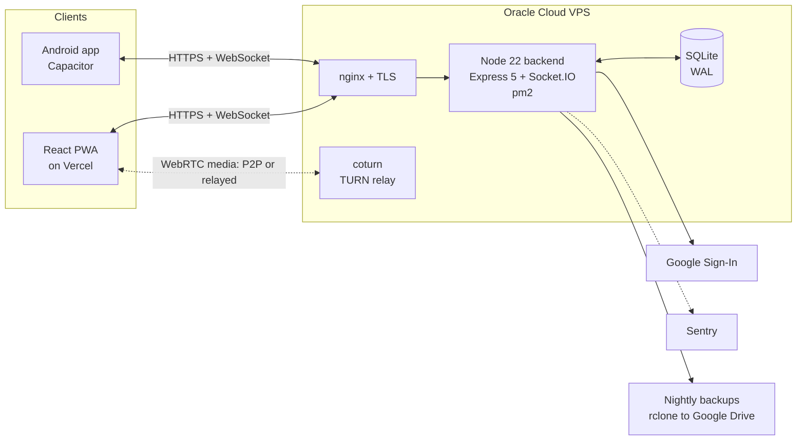

# LpuTV

**Talk to a random student for ten minutes. Nobody sees who you are until you both say yes.**

LpuTV is an anonymous-first chat booth for university students: two people are paired at random for a ten-minute text chat, video unlocks if both want it, and names are revealed only after both sides accept a friend request.

**Live:** https://lputv.vercel.app

Designed, built and operated solo by Deepanshu Lathar: product, frontend, backend, realtime infrastructure, deployment and monitoring.

| | |
|---|---|
| **Status** | Live at lputv.vercel.app; the backend runs on a single VPS |
| **Stack** | React 19 + Vite PWA, Node 22 + Express 5 + Socket.IO, SQLite (WAL), WebRTC with coturn |
| **Tests** | 47 backend tests (about 84% line coverage), two-browser Playwright end-to-end flow, CI with npm audit and gitleaks |
| **Load test** | 10,000 simulated users against a copy of the release on the production VPS (clients on the same machine), details in [docs/LOADTEST.md](docs/LOADTEST.md) |
| **My role** | Everything: product, frontend, backend, realtime, deployment, monitoring |

## Screenshots

| Landing | Dashboard | A chat |
|---|---|---|
|  |  |  |

## Tech stack

- **Frontend:** React 19 + Vite, PWA with service worker, Socket.IO client, Hindi + English i18n, Capacitor Android wrapper. Deployed on Vercel.
- **Backend:** Node 22, Express 5, Socket.IO, SQLite via `node:sqlite` (WAL, versioned migrations), Google Sign-In (ID-token flow, no client secret), web-push notifications.
- **Infrastructure:** single Oracle Cloud VPS, pm2 with gated zero-downtime deploys and automatic rollback, nginx + TLS, self-hosted coturn for WebRTC NAT traversal, nightly SQLite backups shipped to Google Drive via rclone, Sentry error monitoring, daily digest alerts.
- **Quality:** 47 backend tests (~84% line coverage), Playwright end-to-end tests that run the full flow in two browsers with fake camera and mic, CI on every push (backend tests, frontend build, e2e, npm audit, gitleaks).

## Hard problems solved

- **10,000 concurrent chatters on the live VPS, zero failures.** Measured on production hardware (2 vCPU, 12 GB, shared box): every stage matched 100% up to 10,000 users; p95 match time stays under the 5 s target through 8,000 users with server CPU at ~45% of one core and RSS at 555 MB. Full report in [docs/LOADTEST.md](docs/LOADTEST.md).
- **Zero-downtime deploys with automatic rollback.** `deploy/deploy.sh` starts the new release on a spare port, smoke-tests it behind nginx, flips traffic only when it passes, and rolls back on failure. A parallel staging app on port 3101 gets the same pipeline.
- **Phone login without storing phone numbers.** Optional WhatsApp OTP sign-in: numbers and codes are HMAC-hashed at rest, codes expire in 10 minutes, and a layered rate limit plus kill switch protects the sender. Pluggable sender interface, ready for the official WhatsApp Cloud API.
- **Anonymous by default, provably.** Strangers see only random aliases; the server relays text without storing it; video is peer-to-peer WebRTC with coturn as fallback. The test suite scans the database to prove no messages persist.
- **Mutual consent enforced server-side.** Enjoy, extend, friend, video and name-reveal each require both sides; every socket event re-checks room membership and consent state, so no client can skip a step.
- **Safety without moderators.** A report ends the chat and blocks the pair; repeated distinct reports suspend the account automatically; device-level bans stop instant re-registration; every admin action lands in an append-only audit log.
- **A pm2 fork-mode gotcha.** pm2 loads fork-mode apps through `ProcessContainerFork.js`, so `process.argv[1]` never matched `server.js` and its self-start guard silently skipped startup. `deploy/pm2-entry.mjs` starts the server explicitly with the same shutdown handling.

## Architecture



## How it fits together

```
frontend/   React 19 + Vite. Screens in src/screens, hooks/libs in src/lib, Hindi + English (src/i18n).
            PWA (sw.js, manifest), Capacitor Android wrapper in android/ (not distributed).
backend/    Node 22 + Express 5 + Socket.IO, SQLite via node:sqlite (WAL, versioned migrations).
            src/routes (auth, me, public), src/realtime (matching queue, rooms, presence, WebRTC signalling),
            src/admin (metrics + API), admin/ (admin panel UI), jobs (rollups, retention, backups, alerts).
deploy/     pm2, nginx, coturn, deploy.sh (gated, auto-rollback), smoke test, cron, logrotate.
e2e/        Playwright: two browsers with fake camera/mic run the whole flow.
docs/       Runbook, data inventory, breach plan, decisions, load test report.
```

### What the server guarantees

- **Nobody is identified before both say yes.** Strangers get a random alias; names and profiles are sent only after mutual friend acceptance. Emails never leave the server.
- **Every room action is authorised.** Sockets need a valid session; every event checks room membership; enjoy, friend, extend and video steps need both sides, tracked server-side.
- **Messages and video are never stored.** Text is relayed only; video is peer-to-peer (or relayed by your own TURN). Tests scan the database to prove it.
- **Safety:** Report (with reason and note) ends the chat and blocks the pair; several distinct reports suspend an account automatically; device-level bans stop instant re-registration; all admin actions go to an append-only audit log.
- **Consent:** 18+, terms and privacy consent stored with a timestamp; export and delete your data from Settings.

## Run it locally

```bash
cd backend && npm install && npm run dev          # http://localhost:3001  (data in backend/data/)
cd frontend && npm install && npm run dev         # http://localhost:5173
```

Admin panel locally: start the backend with `ADMIN_DEV_TOKEN=dev`, open http://localhost:3001/admin and sign in with `dev`.

## Tests

```bash
cd backend && npm test                 # 47 tests: auth, room authorisation (B1-B6), queue, cleanup, migrations, backups, admin, CSV
cd backend && npm run test:coverage    # ~84% of lines
cd frontend && npm run lint && npm run build
cd e2e && npm install && npx playwright install chromium && npx playwright test
cd backend && npm run loadtest         # see docs/LOADTEST.md
```

CI (`.github/workflows/ci.yml`) runs all of this on every push plus `npm audit` and a gitleaks secret scan.

## Configuration

Backend: `backend/.env.example` (every variable explained). On Render none are required: it detects `RENDER=true`, allows `https://lputv.vercel.app`, and generates its secrets on first boot. Set `GOOGLE_CLIENT_ID` + `ADMIN_EMAILS` for Google sign-in and the admin panel, `TURN_*` for reliable video across mobile networks, `VAPID_*` (`npm run vapid`) for push, `ALERT_WEBHOOK_URL` for the daily digest and spike alerts.

Frontend: `frontend/.env.example` (`VITE_BACKEND_URL`, optional `VITE_SENTRY_DSN`, grievance contact).

## Deploy

- **Frontend:** push to `main`; Vercel builds and serves https://lputv.vercel.app.
- **Backend:** runs on an Oracle Cloud VPS under pm2 (app `lputv`, Node 22, port 3001, behind nginx at https://api.lpu.picapool.tech). `deploy/deploy.sh` fetches `main`, installs, gates the new release on a spare port with a smoke test, then reloads pm2 and auto-rolls back on failure. `deploy/deploy.sh --staging` deploys to a parallel staging app on port 3101. Layout: `/srv/lputv` (bare mirror, working clone, `releases/<sha>`, `current` symlink). See `docs/RUNBOOK.md`.
- **Video:** coturn on the same host (`turn.lpu.picapool.tech`, UDP/TCP 3478, TLS 5349); the app advertises it via `TURN_URLS`.

### Production configuration

Backend env lives in `/etc/lputv/production.env` (loaded via `ENV_FILE`; never committed). Names only - see `backend/.env.example` for the full list and meanings: `GOOGLE_CLIENT_ID`, `ADMIN_EMAILS`, `ALLOWED_ORIGINS`, `DB_PATH`, `TURN_URLS`/`TURN_SECRET`, `VAPID_*`, `ALERT_WEBHOOK_URL`, `SENTRY_DSN`, `GROQ_API_KEY`, `ANALYTICS_SALT`, `DEVICE_SALT`, `BACKUP_DIR`, `BACKUP_REMOTE`.

### Backups

Nightly at 01:15 UTC (user crontab): `scripts/backup.mjs` snapshots the SQLite database, keeps the last 9 locally under `/var/lib/lputv/backups/`, and ships a copy to Google Drive via rclone (`gdrive:uniconnect-backups`). Backup config is in `deploy/crontab.txt`.

### Monitoring

- `GET /health` on the API returns release, uptime, memory, queue and cache stats.
- Sentry (`SENTRY_DSN`, org `lputv`, project `lputv-backend`) captures unexpected server errors; init is in `backend/src/errors.js` and is a no-op when the DSN is unset.
- Daily digest + spike alerts go to `ALERT_WEBHOOK_URL`.

### Admin panel

`https://api.lpu.picapool.tech/admin` - sign in with Google; only emails in `ADMIN_EMAILS` get in. All admin actions land in an append-only audit log.

### Legal

In-app pages: Privacy, Terms and Rules (`frontend/src/screens/Legal.jsx`). The grievance contact shown there is set with `VITE_GRIEVANCE_NAME` / `VITE_GRIEVANCE_EMAIL`. Data export and account deletion are self-serve in Settings.

## License

MIT
